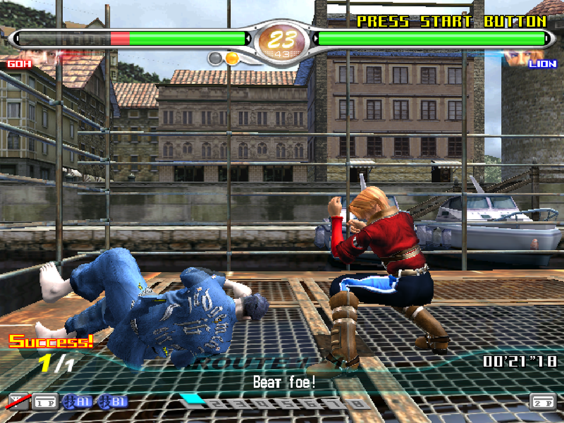
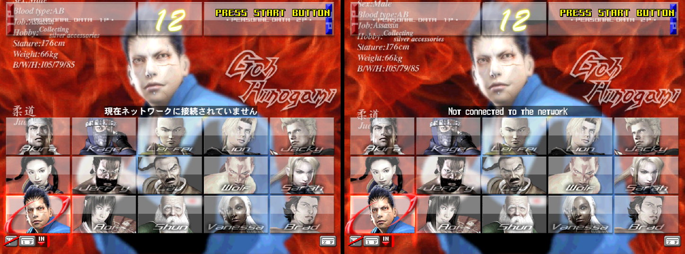
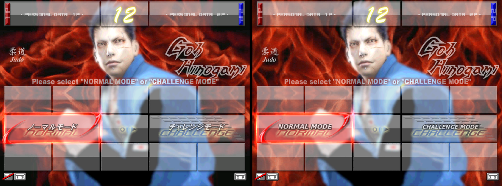
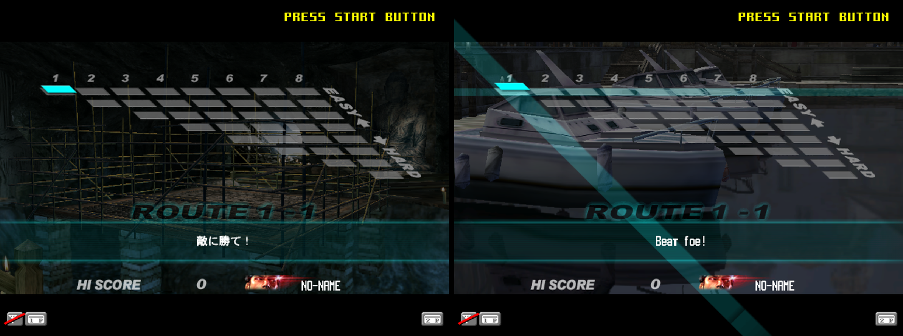
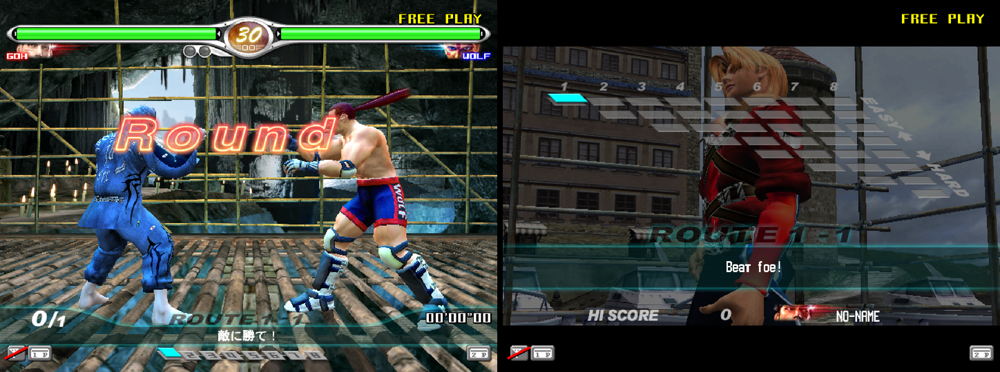
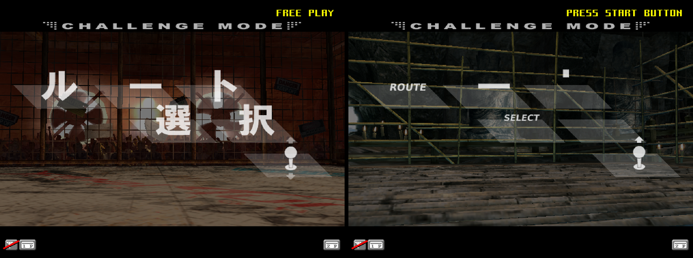
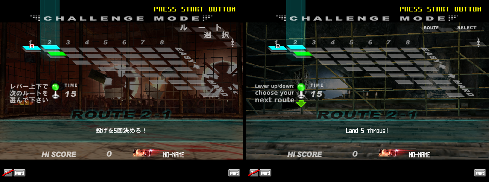
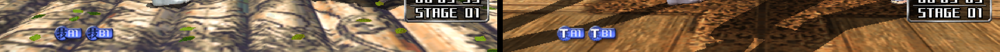
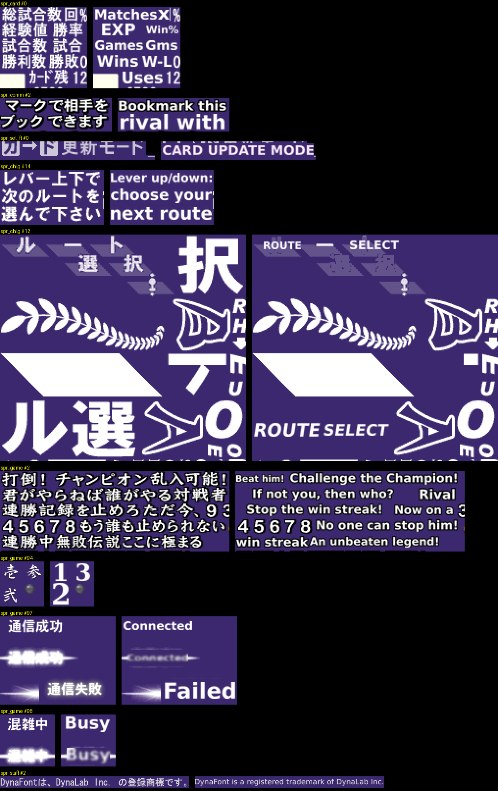

# Virtua Fighter 4 Final Tuned English (Sega NAOMI 2)

An English translation of the arcade game *Virtua Fighter 4 Final Tuned*
(Sega AM2, 2004, Ver. B, MAME/Flycast set `vf4tuned`, GD-ROM `GDS-0036F`),
for the [Flycast](https://github.com/flyinghead/flycast) emulator.

Final Tuned is the last and most complete revision of VF4. It was only
released in Japanese arcades and never got a home port, so its new
features (Challenge Mode, the card dialogs, the mode select) exist only in
Japanese. This project patches the GD-ROM: the text of the main program
and the Japanese graphics are rewritten in English, and the result is a
normal CHD that Flycast loads in place of the original one.



*A Challenge Mode mission in the English build: the mission objective
"Beat foe!" in the HUD.*

## Status

| Part | State |
|---|---|
| Character select, mode select (Normal / Challenge) | English, checked in the emulator |
| Challenge Mode: mission objectives (~100), HUD, result texts, pause dialog | English, checked in the emulator |
| Challenge Mode: route selection title and instructions | English, checked in the emulator |
| Offline settings (network and card off) | `nvram/vf4tuned.zip.nvmem`, checked in the emulator |
| Card dialogs (insert, save, update, copy, errors…), ~90 lines | English, not reachable without a card |
| VF.NET / Quest / network messages | English, partly checked (network status) |
| Card statistics labels, VF.NET rival bookmark hint, network badges | English graphics, not reachable without a card/network |
| Champion / challenger phrases (win streaks) | English graphics, not checked in the emulator |
| Staff roll trademark line | English |
| Technique icon in the fight HUD (技 → T, next to A1/B1) | English graphics, checked in the emulator |
| Rank and title names (十級 … 十段, 拳聖, 覇王 …) | **Japanese** (see below) |
| Title (通り名) kanji sprites, prize battle banners, region emblems | **Japanese** |

Known limits:

- The 132 rank and title names are kept in Japanese. The game draws them
  with calligraphic kanji sprites looked up one character at a time;
  replacing them needs code changes and English sprites. They only appear
  with a player card or VF.NET data.
- The in-game font draws a few lowercase letters in its own style (the
  "g" in "Tough" looks unusual). That is the original font.
- The test menu was already in English and is untouched.
- The fighting-style kanji on the character profiles (八極拳, 柔道 …) are
  kept: each one already has its English name under it.

## Screenshots

Japanese original on the left, English build on the right. All taken in
Flycast with the patched CHD.

| | |
|---|---|
| Character select |  |
| Mode select |  |
| Mission briefing |  |
| Mission HUD |  |
| Route selection title |  |
| Route selection |  |
| Technique icon (技 → T) |  |

All the redrawn textures, original on the left and English on the right
(upright, on a dark background):



## Playing offline (no network, no card)

Out of the box the game is set up for VF.NET: at every boot it waits about
a minute for the network ("NOW NETWORK CHECKING"), and the character
select shows "Not connected to the network". The operator manual
(service manual 420-6621-0036J, pages 22 and 25–26) gives the settings for
a cabinet without VF.NET:

| Menu | Item | Value |
|---|---|---|
| SYSTEM MENU → NETWORK SETTING | NETWORK TYPE | NONE |
| GAME TEST MODE → GAME ASSIGNMENTS | NETWORK | OFF |
| GAME TEST MODE → GAME ASSIGNMENTS | CARD 1P USE | OFF |
| GAME TEST MODE → GAME ASSIGNMENTS | CARD 2P USE | OFF |
| GAME TEST MODE → GAME ASSIGNMENTS | CARD START | OFF (default) |

`nvram/vf4tuned.zip.nvmem` is Flycast's backup RAM with exactly these
settings (made with the menus above, nothing patched). Copy it to the
Flycast save folder before starting the game:

- RetroArch: `saves/Flycast/reicast/vf4tuned.zip.nvmem`
  (or `saves/reicast/` when saves are not sorted by core)
- standalone Flycast: its data folder, next to the other `.nvmem` files

With it the boot check takes 2 frames instead of 60 seconds (the network
status screen reads "(GAME) NETWORK OFF"; Start skips it) and the
character select has no network message and no card icons.

The other game settings in the file are the ones Flycast starts with for
this set (enemy level NORMAL, 3 rounds, 45 seconds, stage SELECTIVE,
continue ON).

To change them yourself: in Flycast enable the core option "Allow NAOMI
service buttons" (RetroArch: L3 = TEST, R3 = SERVICE). Press TEST for the
SYSTEM MENU, SERVICE moves the arrow, TEST selects or changes a value.
Settings are written only when you leave with EXIT up to the SYSTEM MENU
and EXIT again; then quit the emulator normally so it saves the file.

## Building the English CHD

You need the files of the MAME/Flycast set: `gds-0036f.chd` and
`vf4tuned.zip` (it holds the PIC `317-0387-com.pic` with the GD-ROM key).

```
./build.sh gds-0036f.chd vf4tuned.zip patch/vf4ft_en.vfp gds-0036f_en.chd
```

Needs `python3` (standard library only), `chdman` (MAME tools) and a
C/C++ compiler; the two small native helpers are compiled on the fly.
Temporary files go to `$TMPDIR` (about 1.6 GB).

Then, in your Flycast ROM folder, replace `vf4tuned/gds-0036f.chd` with
the generated file (keep a copy of the original). The `vf4tuned.zip` and
the NAOMI 2 BIOS (`naomi2.zip`) stay as they are.

Flycast does not check the CHD hash; it only compares it between the two
players in GGPO netplay, so both players need the same CHD.

Steps of `build.sh`:

1. extract the CHD to a GDI image (`chdman extractcd`)
2. extract and decrypt the game file `VF41_S.BIN` with the PIC key
3. apply `patch/vf4ft_en.vfp` (checks the SHA1 before and after)
4. encrypt it again and write it over both copies on the disc
   (`VF41_S.BIN` and `VF41_S2.BIN`), regenerating EDC/ECC
5. compress the new CHD (`chdman createcd`)

Input and output:

| File | SHA1 |
|---|---|
| `gds-0036f.chd` (original) | 68edece4239e5adfef9df143defb711ff2b4db72 |
| `317-0387-com.pic` (CRC32 8728aeaa) | 07983ab41d143f845c3150dfc9b7301968708e18 |
| `VF41_S.BIN` decrypted, original | 5b385f6b26fef97a769581769feb3319f39dd52c |
| `VF41_S.BIN` decrypted, English | 04df48b3a56bc5703005c694a38cad7f2131daf3 |
| `gds-0036f_en.chd` | f08560fa559aea191183fa2570a0d412a51d6813 |

The build is reproducible: the same input gives the same CHD.

## Rebuilding the patch

`make_patch.sh` redoes the patch from the translation sources:

```
./make_patch.sh gds-0036f.chd vf4tuned.zip [patch/vf4ft_en.vfp]
```

Extra Python modules: Pillow, numpy, scipy; fonts: DejaVu
(`/usr/share/fonts/truetype/dejavu`). The result is identical byte for
byte to `patch/vf4ft_en.vfp`.

| Source | Content |
|---|---|
| `text/translations.py` | the English text, by file offset; tags such as `<msn_num>` are kept |
| `text/strings_cap.tsv` | every EUC-JP string of the program with the bytes available for it |
| `text/gfx_spec.py` | the graphics edits: texture, box, English text, style |
| `text/gfx_mode_sel.py`, `text/gfx_sel_ft.py` | the two mode select textures (styled by hand) |
| `text/gfx_skill_icon.py` | the technique icon: 技 replaced by a white "T" |

To change a translation, edit the source and run `make_patch.sh`;
`tools/apply_text.py` refuses lines longer than their slot.

## Tools

| Script | Purpose |
|---|---|
| `build.sh` | original CHD + PIC + patch → English CHD |
| `make_patch.sh` | sources → `patch/vf4ft_en.vfp` |
| `tools/naomigd_des.cpp`, `tools/naomi_des.h` | DES decrypt/encrypt of the GD game file with the PIC key (Flycast's routine) |
| `tools/cdecc.c` | Mode 1 EDC/ECC for 2352-byte sectors (`--check` to verify a track) |
| `tools/gdtool.py` | list / extract / inject files in the GDI image |
| `tools/sffs.py` | list / extract the SimpleFlashFS inside the game file |
| `tools/pvrtex.py` | PowerVR2 textures: decode and encode (twiddled, rectangle, VQ; 1555/565/4444) |
| `tools/spr_sheets.py` | render every sprite set to contact sheets |
| `tools/sprtool.py` | export sprite textures as upright PNGs, import edited PNGs |
| `tools/redraw.py` | redraw text areas of textures from a spec |
| `tools/apply_text.py` | write the text table into the game file |
| `tools/vfpatch.py` | make / apply `.vfp` patches |
| `tools/euc_scan.py`, `tools/sjis_scan.py` | find Japanese strings |
| `tools/build_tools.sh` | build the native helpers |
| `nvram/vf4tuned.zip.nvmem` | Flycast backup RAM: network and card off |
| `test/` | headless Flycast test harness (see below) |

Editing a texture by hand:

```
python3 tools/sprtool.py sets   VF41_S.dec
python3 tools/sprtool.py export VF41_S.dec spr_mode_sel.bin edit/
#   edit edit/spr_mode_sel_NN.png (same size, RGBA, as it looks on screen)
python3 tools/sprtool.py import VF41_S.dec edit/ VF41_S_en.dec
python3 tools/vfpatch.py make   VF41_S.dec VF41_S_en.dec my.vfp
```

## Testing

The screenshots and checks were made with the Flycast libretro core,
built from source, running headless in RetroArch (Xvfb, Mesa llvmpipe),
driven by `test/ra.sh` (keys through xdotool, screenshots through the
RetroArch network commands) and `test/run_path.sh`, which plays the
path above: boot, character select, mode select, one Challenge mission
(attacks mashed), results, route selection.

```
mkdir -p test/work/system/dc test/work/roms
cp flycast_libretro.so test/work/          # cmake -B build -G Ninja -DLIBRETRO=ON -DUSE_VULKAN=OFF
cp naomi2.zip test/work/system/dc/
cp vf4tuned.zip test/work/roms/
test/run_path.sh gds-0036f_en.chd en 36    # screenshots in test/work/shots/
```

Needs `retroarch`, `xvfb`, `xdotool`, `dbus-run-session`. `ra.sh start`
copies `nvram/vf4tuned.zip.nvmem` into the work folder when none is
there; `ra.sh quit` closes RetroArch cleanly so the backup RAM is saved.
The core options use the `reicast_` prefix of the libretro core, and
`global_core_options` makes RetroArch read `test/core.opt`.

## Technical notes

### Disc and encryption

The GD-ROM has three tracks; the HD area (track 3, LBA 45000) is an
ISO 9660 volume:

| File | LBA | Size |
|---|---|---|
| BHX.BIN | 303233 | 256 — boot index, names `VF41_S.BIN` |
| BHX.1GB | 303232 | 256 — same for 1 GB DIMM boards, names `VF41_S2.BIN` |
| VF41_S.BIN | 303234 | 251658240 |
| VF41_S2.BIN | 426114 | 251658240 — identical copy |
| NAOMIGD.BIN | 548994 | 12288 |

The DIMM board decrypts the game file with DES. The key comes from the
PIC: 7 bytes at 0x780 (every other byte) plus the byte at 0x7a0, here
`C775D05831E0B3D3`; the file name comes from 0x7c0/0x7e0 (`BHX.BIN`).
Flycast's routine is standard DES with the key and each 8-byte block
byte-reversed. There is no integrity check: a re-encrypted file loads.

The tracks are stored as 2352-byte sectors, so writing a file back means
regenerating the Mode 1 EDC/ECC of each sector (`tools/cdecc`). On the
original tracks the tool changes 0 sectors.

### Game file

`VF41_S.BIN` (decrypted) starts with the NAOMI 2 header
(`VF4 FINAL TUNED`, regions JAPAN/USA/EXPORT/KOREA/AUSTRALIA):

| Range | Content |
|---|---|
| 0x000000 | NAOMI 2 header; load table at 0x360, test table at 0x3c0 |
| 0x020000–0x360000 | main program (SH-4), loaded at 0x0c020000 |
| 0x360000–0x3e0000 | test mode program, also loaded at 0x0c020000 |
| 0x800000–0xe2b7d80 | SimpleFlashFS, 908 files |

### SimpleFlashFS

A volume header at 0x800000 (`SimpleFlashFS`, `1999.5.5`), files from
0x801000. Each file is a 0x100-byte header followed by the data:

| Offset | Content |
|---|---|
| +0x04 | bytes taken by the entry (header + data, multiple of 4 KB) |
| +0x0c | data size |
| +0x10 | CRC-16/XMODEM of the stored data |
| +0x14 | mtime |
| +0x18 | unix mode |
| +0x1c | a 16-bit value, not checked by the game |
| +0x80 | name |

647 files are gzip streams (`*.bin.gz`: models, textures, objects).
The game does not check either CRC; `sprtool.py` updates +0x10 anyway.

### Text

The program text is EUC-JP (not Shift-JIS), NUL-terminated, at
0x21b3d8–0x239a90, plus the network message at 0x221c04. Each string is
padded to a 4-byte boundary, so most English lines fit in place; the
pointers do not move. Some strings are used from a later offset too
(強い敵に勝て！ is also shown as 敵に勝て！ by skipping 4 bytes), so the
English keeps a meaningful tail there.

Mission strings use tags that the game fills in: `<msn_num>`, `<para>`,
`<waza>`, `<nage>`, `<finish>`, `<kamae><hyper1>…`, `<COL_CUSTOM1>`,
`<BR>`. The renderer draws ASCII with the same font.

The 16×16 kanji font `spr_asc` (31 VQ textures) holds the JIS set in
Shift-JIS order (190 codes per lead byte); it is used for player names
and data coming from the card or VF.NET.

### Sprites

A table in the main program at 0x322154 (RAM 0x0c322154) lists 108
sprite sets: name pointer, VRAM slot, pointer to the texture records.
A record is `(w << 16 | h, kind << 8 | pixel format, offset, 0)`:

- kind 0x1 twiddled, 0x3 VQ (256-entry codebook of 2×2 blocks), 0xd
  twiddled rectangle
- pixel format 0 = ARGB1555, 1 = RGB565, 2 = ARGB4444

The textures have no header. Sprite art is stored rotated by 90°;
`sprtool.py` exports it upright and rotates it back on import. 16-bit
textures re-encode byte for byte; VQ textures use a k-means encoder.

## Credits

Translation and hacking by Vanni Brutto (Zanac).

`tools/naomi_des.h` contains the DES routine and tables of Flycast
(`core/hw/naomi/gdcartridge.cpp`, GPL-2.0).

The game is © SEGA / SEGA-AM2 2004. Building the CHD needs your own copy
of the game; this repository contains only the patch and the tools.
